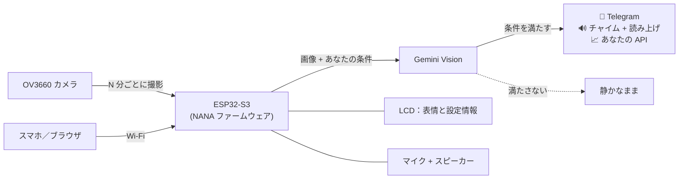
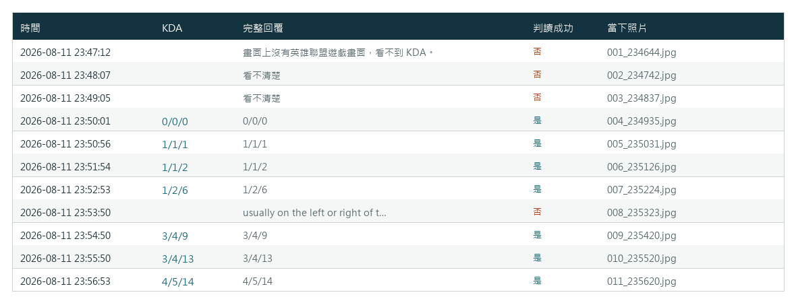
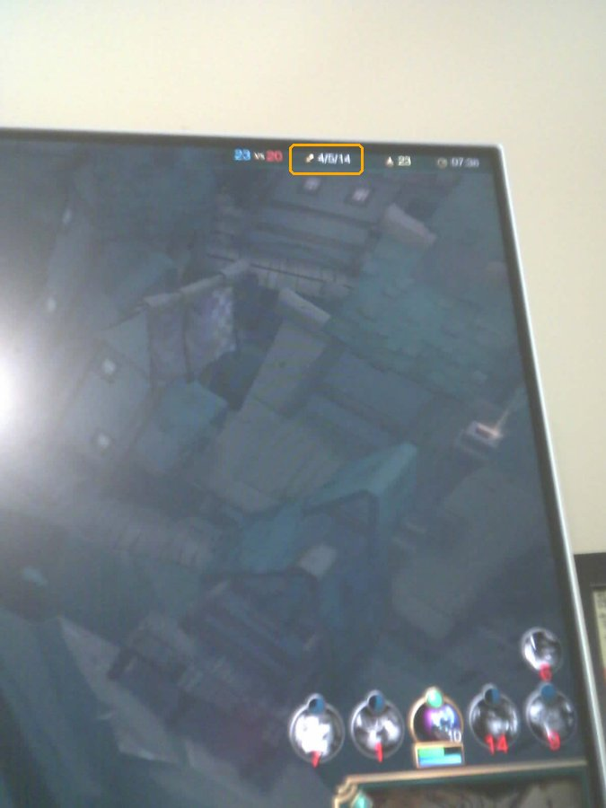
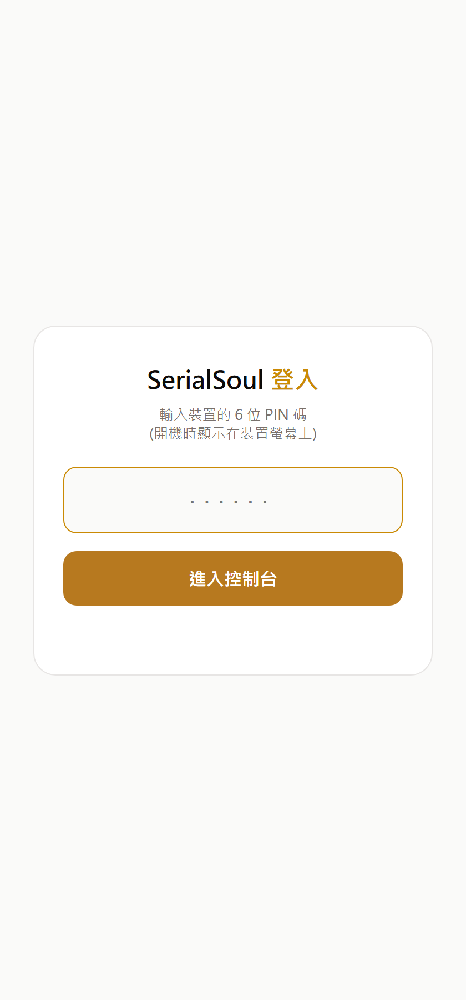
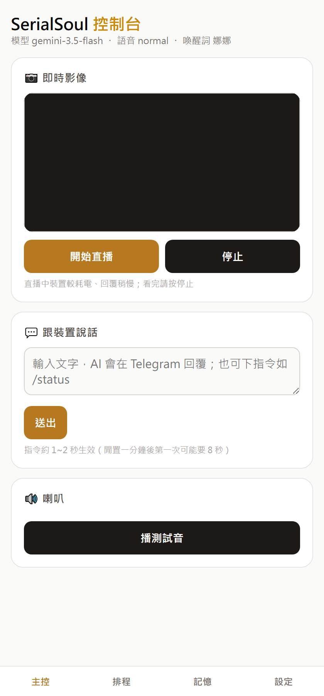
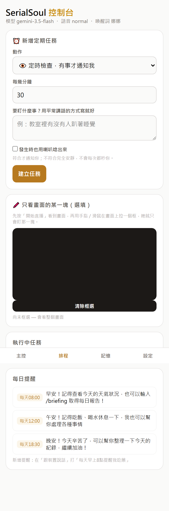
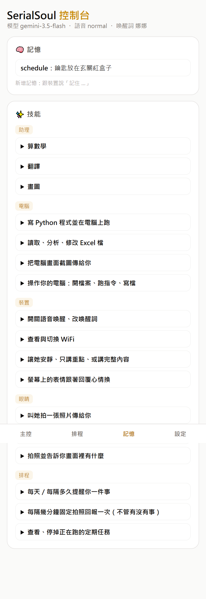
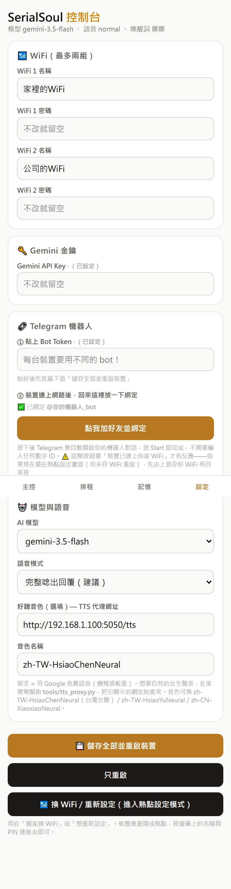

<h1 align="center">NANA</h1>

<h3 align="center">代わりに見張ってくれる AI —— 何もなければ静か、何かあったときだけ知らせる。</h3>

<p align="center">
  約 15 ドルの ESP32-S3 カメラを、メーター・ドア・機械・画面に向けるだけ。<br>
  何を見張るかを一文で伝えれば、数分ごとに確認して、条件を満たしたときだけ通知します。<br>
  <b>サーバー不要・PC 不要・コード不要。システム全体が 1 つのチップで動きます。</b>
</p>

<p align="center">
  <a href="https://github.com/ry6612-pixel/nana-esp32/stargazers"></a>
  <a href="../../actions/workflows/build.yml"></a>
  
  
  <a href="LICENSE-MIT"></a>
</p>

<p align="center">
  <a href="README.md">English</a> · <a href="README.zh-TW.md">繁體中文</a> · <b>日本語</b>
</p>

<p align="center">
  
</p>

---

## なぜ NANA なのか

現場にはよくあります：機械のパネルに数値は出ているのに、システムにはつながらない。つなごうとするとメーカーは「機械ごと交換」と言う。結局、誰かが定期的に見に行く —— 忙しいと見逃し、見逃してから問題に気づく。

NANA がその見回りを代わりにします：

```
あなた：「10 分ごとに圧力計を見て、80 を下回ったら知らせて」
NANA： （10 分ごとに撮影し、Gemini Vision に読み取らせる）
       …… 正常な間はずっと静か ……
       🔔「圧力計の値は 76 です。80 を下回りました」 → Telegram + チャイム + 読み上げ
```

- **プロジェクトではなく、一文で。** RTSP もポート開放もサーバーも Python も不要。依頼があいまいなら（「生産ラインを見ておいて」）、勝手に推測せず、何をどのくらいの間隔で見るかを聞き返します。
- **普段は静か。** 条件付きタスクは条件を満たしたときだけ発言します。録画して後から見返す監視カメラとは違い、その場で判断します。
- **設備に手を加えない。** 機械から見れば、横にカメラが 1 台増えただけ。配線も改造もメーカーの許可も不要です。
- **読めなければ正直に言う。** 読み取れないときは数字をでっち上げず「読めない」と報告します。3 ラウンド連続で失敗すると（レンズが塞がれた、Wi-Fi 断、クォータ切れ）知らせるので、監視が黙って止まることはありません。

---

## できること

| | 機能 | 使い方 |
|---|---|---|
| 👁️ | **条件付き監視** | 「オーブンの近くに誰かいたら教えて」—— 定期撮影、AI が条件を判定、一致したときだけ通知。ライブ映像上で範囲を囲めば、その部分だけを見張ります。 |
| 🔢 | **数値の読み取りと記録** | N 分ごとにメーター・計数器・画面上の数値を読み、固定の JSON 形式で自分の API／スプレッドシートに POST。読めないときは空の値を送り、偽の 0 は送りません。 |
| 📸 | **定期写真レポート** | 「1 時間ごとに玄関の写真を送って」—— 何があってもなくても送ります。 |
| ⚡ | **タイマーで機器を ON/OFF** | GPIO からリレーをスケジュール制御（ポンプ、照明、ファン）。 |
| ⏰ | **リマインダー** | 「毎朝 8 時に薬を飲むよう知らせて」—— Telegram に届きます。 |
| 🗣️ | **音声** | ウェイクワード、プッシュトゥトーク、音声での返答（TTS）。声で質問すれば声で答えます。 |
| 🧠 | **記憶** | 「鍵は赤い箱の中」と覚えさせれば、後で聞いても答えられます。チップ内に保存され、電源が切れても消えません。 |
| 🧩 | **24 の内蔵スキル** | うち 4 つは依頼があいまいなときにヒアリングする「コンサルタント」：監視アドバイザー、設置ガイド、レポート設定、トラブルシューティング。自分のスキルも普通の文章で追加できます。 |
| 🖥️ | **デバイス内蔵の Web コンソール** | 同じ Wi-Fi のブラウザで IP を開くだけ：ライブ映像、チャット、タスク、記憶、設定。アプリ不要。 |
| 💬 | **Telegram（任意）** | 外出先でも通知を受け取れます。コンソールからワンタップで連携。 |
| 😊 | **ステータス表示ではなく「顔」** | 返答の雰囲気に合わせて 4 種類のイラスト表情を切り替え、話している間は口が動きます。漢字も正しく表示（13,802 字のビットマップフォント内蔵）。 |
| 🔄 | **自己管理** | 最大 5 つの Wi-Fi を自動切り替え、ヘルスチェック、ウォッチドッグ、定時の自動再起動、Wi-Fi／Telegram 経由のファームウェア更新（OTA）。 |

---

## 仕組み



撮影、スケジュール、Web コンソール、Telegram、リトライ、記憶 —— すべて Rust で ESP32-S3 上で動きます。外部サービスは AI モデル（Google Gemini、あなた自身の API キー）だけです。

---

## 実測：対戦中のゲーム画面の戦績を読む

リーグ・オブ・レジェンドの対戦中のモニターに NANA を向けて、**「1 分ごとにプレイヤーの K/D/A を読んで記録して」**と伝えました。ゲームはメーターより難しいテストです —— 文字は小さく、画面は動き続け、カメラは横向き・斜めから撮っています。

以下は NANA が書いた**未編集のログ**です。1 行が 1 回の読み取りで、判定に使った写真がそのまま付いています（列：時刻 · KDA · 返答全文 · 読み取り成功 · 写真）：

<p align="center"></p>

- 最初の数行は「読めない」—— まだ試合が始まっていませんでした。数字をでっち上げてはいません。
- 1 行だけ数字ではなく英語で返ってきました —— モデルが迷った結果で、推測ではなく読み取り失敗として記録されています。
- 最後の行 **4/5/14** が下の写真です —— 上部バーの K/D/A がログと完全に一致しています：

<p align="center">
  
  
</p>
<p align="center"><sub>デバイスのカメラが撮った元画像（向きを補正し、枠を追加）。読み取り値ごとに写真を残しておくから、ログの正しさを確かめられます —— 数字だけだと、いつももっともらしく見えてしまいます。</sub></p>

<sub>League of Legends は Riot Games, Inc. の商標です。NANA は Riot Games とは無関係で、承認も受けていません。</sub>

---

## 実際の画面

> デバイスが配信する Web コンソールの実際のスクリーンショットです。UI は現在繁体字中国語です —— 翻訳は最初の貢献に最適です。

<table>
<tr>
<td align="center" width="33%"><br><b>PIN ログイン</b><br><sub>デバイスごとのランダム PIN を LCD に表示。5 回間違えるとロック。</sub></td>
<td align="center" width="33%"><br><b>コンソール</b><br><sub>ライブ映像、入力して会話、スピーカーテスト。Telegram なしで動きます。</sub></td>
<td align="center" width="33%"><br><b>監視タスク</b><br><sub>何を見張るかと間隔を指定、範囲を囲むことも可能。</sub></td>
</tr>
<tr>
<td align="center"><br><b>記憶とスキル</b><br><sub>覚えていること、各スキルを呼び出す言い回し。</sub></td>
<td align="center"><br><b>設定</b><br><sub>Wi-Fi、キー、Telegram 連携、モデル、音声。</sub></td>
<td align="center"><sub>貢献歓迎：NANA が実際に何かを検知する短い GIF があると、このページがずっと良くなります。</sub></td>
</tr>
</table>

---

## ハードウェア

| 部品 | 説明 | 目安価格 |
|---|---|---|
| **ESP32-S3-N16R8** | 16 MB Flash、8 MB PSRAM —— 必須 | 約 8 ドル |
| OV3660 カメラ | 画像系の機能すべてに必要 | 約 3 ドル |
| ST7789 LCD 240×320 | 表情、設定情報、コンソールの IP と PIN | 約 2 ドル |
| I2S スピーカーアンプ（MAX98357A）+ スピーカー | 音声返答、チャイム | 約 1〜2 ドル |
| I2S マイク（INMP441） | 音声入力、ウェイクワード | 約 1 ドル |

**部品代は約 15 ドル。** 必須なのは ESP32-S3 だけで、接続されていない周辺機器は自動検出してスキップします。

<details>
<summary><b>デフォルトのピン</b>（実行中に <code>/camera pins</code>、<code>/lcd pins</code>、<code>/audio pins</code> で変更可能）</summary>

**OV3660（DVP）：** XCLK 15 · SDA 4 · SCL 5 · D0 11 · D1 9 · D2 8 · D3 10 · D4 12 · D5 18 · D6 17 · D7 16 · VSYNC 6 · HREF 7 · PCLK 13 · PWDN/RESET 未使用

**ST7789（SPI）：** RST 21 · DC 47 · BL 38 · SCLK 19 · MOSI 20 · CS 45

**スピーカー（I2S 出力）：** BCLK 40 · WS/LRC 41 · DIN 39

**マイク（I2S 入力）：** SCK 2 · WS 1 · SD 42

</details>

### ランニングコスト

AI の料金はあなた自身の Gemini API キーで Google に直接支払われます。NANA は関与しません。私たちの使用での目安：10 分ごと・1 日 8 時間なら Flash モデルで月 1 ドルを大きく下回り、5 分ごと・24 時間でも数ドル程度です。料金は変わるので Google の最新情報を確認してください。デバイスは AI 呼び出しを毎分 30 回までに制限しています。

---

<a id="クイックスタート"></a>

## クイックスタート

### 1. ファームウェアを書き込む

**ビルド済みイメージ**（[Release](../../releases) がある場合。ツールチェーン不要）：

```bash
cargo install espflash
espflash write-bin -p <ポート> 0x0 NANA-<バージョン>.bin
```

> このイメージは `0x0` から始まり、**ボード上の設定をすべて消去します** —— 新品のボードにはそれが正解です。設定済みのボードを更新するときはアプリだけを書き込んでください（`flash.ps1`）。

**ソースからビルド：**

```bash
git clone https://github.com/ry6612-pixel/nana-esp32.git
cd nana-esp32
cargo install espup espflash && espup install     # Xtensa Rust ツールチェーン
. ~/export-esp.sh                                 # Windows: . $HOME\export-esp.ps1
cargo build --release                             # 初回は ESP-IDF をダウンロード（約 30〜40 分）
espflash flash -p <ポート> --partition-table partitions.csv target/xtensa-esp32s3-espidf/release/esp32
```

Windows では `build.ps1`／`flash.ps1` がこれらをまとめて行います。ウェイクワードのモデルは独立した flash パーティションにあり、`espflash flash` では書き込まれません。音声ウェイクを使うには `make-bin.ps1`（または Release）の単一イメージを一度書き込んでください。以降はアプリだけ更新してもモデルは残ります。

### 2. スマホでセットアップ

1. 電源を入れると、画面にホットスポット名（`NANA-XXXX`）、**ホットスポットのパスワード**、**ログイン PIN** が表示されます。パスワードはセットアップモードに入るたびに変わります。
2. スマホでそのホットスポットに接続すると設定ページが自動で開きます（開かなければ `10.1.1.1`）。PIN でログイン。
3. Wi-Fi と [Gemini API キー](https://aistudio.google.com/apikey) を入力。必要なら [@BotFather](https://t.me/BotFather) の Telegram bot トークンも。保存すると再起動して Wi-Fi に接続します。
4. 画面にコンソールのアドレスと PIN が表示されるので、同じ Wi-Fi のブラウザで開きます。
5. （任意）コンソールの Telegram カードの連携ボタンを押し、Telegram で **Start** をタップ。完了です。

USB でやりたい場合は `provision.ps1` がシリアル経由で同じ設定を送ります。キーがファームウェアに埋め込まれることはありません。

### 3. 見張るものを伝える

コンソールか Telegram に入力：

> 10 分ごとに左のパネルを見て、温度が 35 ℃ を超えたら知らせて、声でも読み上げて。

言い方がわからなければ、やりたいことをそのまま言ってください（「プリンターを見ておいて」）—— 監視アドバイザーのスキルが必要な情報を聞いてきます。

---

## コマンド

すべての機能は普通の言葉で操作できますが、各機能にコマンドもあります（デバイスで `/help` を入力すると一覧が出ます）。

| 分類 | コマンド |
|---|---|
| システム | `/status` · `/diag` · `/tokens` · `/model set flash\|pro\|gemini-<名前>` · `/ai temp auto\|0.0–1.0` |
| カメラ | `/camera snap` · `/camera vision [質問]` · `/camera stream` · `/camera pins …` |
| タスクとリマインダー | `/autotask <一文>` · `/tasks` · `/tasks del <ID>` · `/remind 5m <内容>` · `/remind 8:00 <内容>` · `/reminders` · `/stop` · `/pause` · `/resume` |
| レポート | `/report set <https URL>` · `/report token <トークン>` · `/report test` · `/report off` |
| 記憶とスキル | `/remember <キー> <値>` · `/memories` · `/forget <キー>` · `/skills` · `/skill add 名前\|説明\|トリガー` |
| 音声と画面 | `/voice off\|normal\|brief` · `/audio wake on\|off` · `/audio pins …` · `/lcd pins …` |
| Wi-Fi と更新 | `/wifi set <SSID> <パスワード>` · `/wifi set2…5` · `/wifi swap` · `/setup` · `/ota <https URL>` · Telegram で `.bin` を送信 |
| リセット | `/clear`（会話のみ）· `/reset confirm`（工場出荷状態：Wi-Fi とキーを消去、記憶とタスクは保持） |

---

## 無人で動き続けるための設計

監視デバイスの最悪の故障はクラッシュではなく、**黙って止まること**です。そのため、すべての定期タスクは上限付きのリトライループで動きます：

```
撮影 → AI 判定 → 成功？ ── はい → レポート／通知、リトライ枠をリセット
                     │            （以前に警告していれば「復旧しました」を送信）
                     └── いいえ → 70 秒後に判定温度を上げて再試行（最大 5 回）
                                   3 ラウンド連続失敗 → 一度だけ通知
```

- **リトライでは条件を変えます。** 同じ画像・同じ質問・同じ温度では、たいてい同じ間違いが返ってきます。そのためリトライごとに判定温度を上げ（0.4 → 0.6 → 0.8、上限 0.9）、成功したら 0.4 に戻します。
- **上限あり。** 1 ラウンドのリトライは最大 5 回。壊れたタスクがクォータを使い切ったり、他のタスクを止めたりしません。
- **復旧も通知**するので、いつ正常に戻ったかわかります。
- その下では：ハング時に自動再起動するウォッチドッグ、Wi-Fi のヘルスチェックと切り替え、メモリ監視と自己再起動、午前 4 時の定時再起動。

---

## 読み取り値を自分のシステムへ

```
/report set https://your.domain/api/readings
/report token YOUR_TOKEN        # 任意、Authorization: Bearer で送信
/report test                    # テストデータを 1 件送信
```

URL は設定した時点で検証されます。各読み取り値は固定形式の JSON で POST されます：

```json
{
  "device": "NANA-7A3E",
  "task_id": 68,
  "task_type": "camera",
  "ts": 1785639147,
  "prompt": "read the output figure on screen, digits only",
  "value": "1210",
  "text": "1210",
  "hit": true,
  "ok": true
}
```

| フィールド | 意味 |
|---|---|
| `device` | デバイス名（ホットスポットと同じ）—— 複数台を区別 |
| `task_id`、`task_type` | どのタスクか。`camera`（毎回）、`watch`（条件付き）、`test` |
| `ts` | Unix 秒 |
| `prompt` | 何を見るよう指示されたか |
| `value` | 抽出した数値。読めなかったときは**空文字列** |
| `text` | 返答全文 |
| `hit` | `watch` のみ：条件を満たしたか（満たさなくても送信するので「異常なし」と「動いていない」を区別できる） |
| `ok` | 読み取り自体が成功したか |

3 回続けて送信に失敗すると通知します —— データが黙って消えるのは、レポートしないより悪いからです。

---

## 向いているか

**ぴったり**
- 機械やパネルに数値は出るが、システムに接続できない
- 毎日誰かが目で確認しているもの：温度、水位、圧力、表示灯
- 何かが**いつ**起きたかを知りたいが、誰も監視映像を見ていない
- 記録が必要だが、今は紙に手書きしている

**まだ向いていない**
- 現場に Wi-Fi か電源がない
- 判断したいものが画面に映らない（音、におい、振動）
- ミリ秒単位の反応が必要 —— NANA は数分ごとに確認します
- 精度は照明・角度・反射・文字の大きさに左右されます。頼る前に実際の現場で試してください。読めないときは推測せず「読めない」と報告します。

---

## セキュリティとプライバシー

**組み込みの保護**
- ソースにもファームウェアにも秘密情報は含まれません —— キーはデバイス上で入力し NVS に保存。
- セットアップ用ホットスポットは **WPA2、毎回新しい 8 文字のパスワード**を生成し、画面（と USB シリアルログ）にのみ表示。スイッチ：`SETUP_AP_SECURED`。
- BLE 設定は**デフォルトで無効**（`BLE_PROVISIONING_ENABLED`）。その通信はまだ暗号化されていません。
- Web コンソール：デバイスごとの PIN とロックアウト、HttpOnly セッション Cookie、保存テキストはすべてエスケープして表示。
- Telegram：連携にはログイン済みコンソールのワンタイムコードが必要（個人チャットのみ）。bot はオーナーにしか応答しません。
- 音声の文字起こしは常にチャットとして扱い、コマンドにはなりません。
- PC 制御（下記）はデフォルトでロック。`/pc_unlock` は 10 分間のみ有効。
- OTA は HTTPS の URL のみ受け付けます。チャット内容はシリアルログに書き込みません。

**導入前に知っておくこと**
- 写真・音声・テキストは解析のため Google Gemini に送信されます。
- Web コンソールとライブ映像はローカルネットワーク上で HTTP です。
- キーは flash 暗号化なしで保存 —— 実機を手にした人は読み出せます。
- OTA イメージは署名検証されません。
- カメラ製品です：撮影範囲の人に監視していることを伝え、現地のプライバシー法令に従ってください。

問題を見つけたら issue を（機微な内容は非公開の security advisory で）お願いします。

---

## 実験的機能：PC 制御

ファームウェアは USB 経由の JSON Lines プロトコルを内蔵しており、接続された PC でスクリーンショット、ファイルを開く、コマンド実行、Excel 操作を AI が行えます。**PC 側のドライバーはまだ公開していない**ため、現時点ではこれらのコマンド単体では動きません。いずれにせよデフォルトでロックされています。

---

## よくある質問

<details><summary><b>Telegram は必須？</b></summary>
いいえ。Web コンソールですべてできます。Telegram は外出先で通知を受け取るためだけです。
</details>

<details><summary><b>どの言語に対応？</b></summary>
書いた・話した言語で返答します。コンソール UI は現在繁体字中国語です。
</details>

<details><summary><b>他の AI モデルは使える？</b></summary>
Gemini のモデルなら何でも：<code>/model set gemini-&lt;名前&gt;</code>。デフォルトの <code>gemini-flash-latest</code> は Google の最新 Flash モデルに自動で追従します。
</details>

<details><summary><b>xiaozhi-esp32 との違いは？</b></summary>
xiaozhi-esp32 は優れた音声チャットアシスタントです。NANA は「見張る」ことが中心：定期的な画像判定、条件付き通知、読み取り値を自分のシステムへ。役割が違い、補い合えます。
</details>

<details><summary><b>OpenClaw／ZeroClaw との違いは？</b></summary>
それらは PC やサーバー上で動く AI エージェント基盤です（ESP32 を周辺機器として使えます）。NANA にはホストがありません —— ESP32-S3 そのものがシステム全体です。
</details>

---

## コントリビュート

issue と PR を大歓迎します —— 特に英語／日本語のコンソール UI、ブラウザからの書き込みツール、他ボードのピンプリセット、実際の利用場面のデモ GIF。

NANA のおかげで見回りが一回減ったら、**⭐ をいただけると他の人が見つけやすくなります。**

## ライセンス

[MIT](LICENSE-MIT) または [Apache-2.0](LICENSE-APACHE) のデュアルライセンス（どちらか選択）。`assets/font16.bin` のビットマップフォントは Noto Sans TC から派生しており、[SIL Open Font License 1.1](assets/font16.OFL.txt) に従います。

NANA は以前 *SerialSoul* という名前で開発されていたため、コードやコンソールの一部にその名前が残っています。

## 謝辞

- [Espressif](https://www.espressif.com/) —— ESP32-S3 と ESP-IDF
- [esp-rs](https://github.com/esp-rs) —— ESP32 で Rust を
- [Google Gemini](https://ai.google.dev/) —— 判定を担う画像モデル
- [xiaozhi-esp32](https://github.com/78/xiaozhi-esp32) —— ESP32 の AI コンパニオンの可能性を示してくれたプロジェクト
- [Noto Sans TC](https://fonts.google.com/noto/specimen/Noto+Sans+TC) —— 漢字フォント
