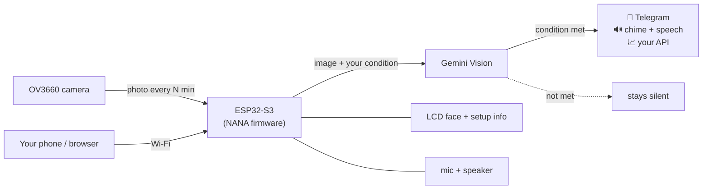
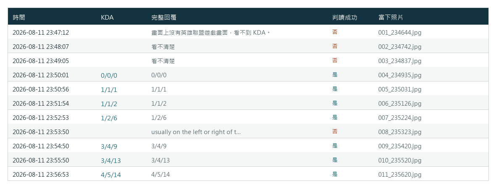
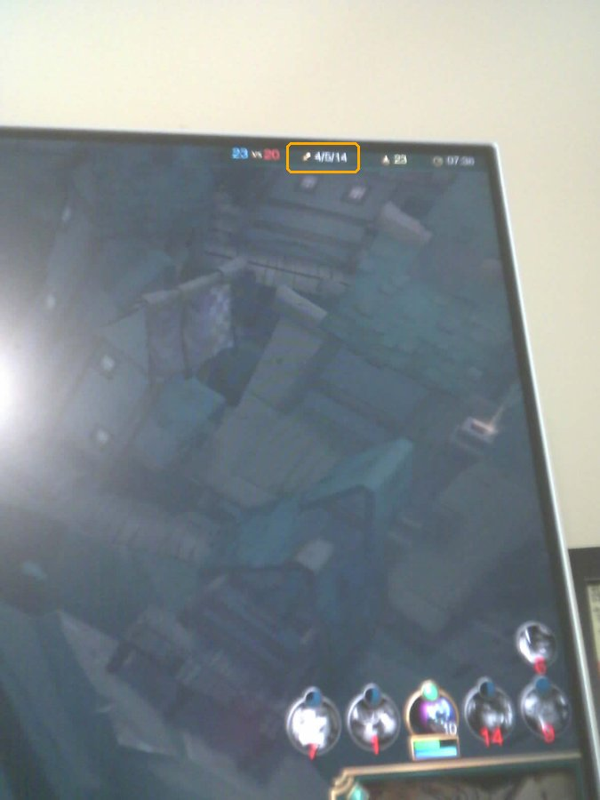
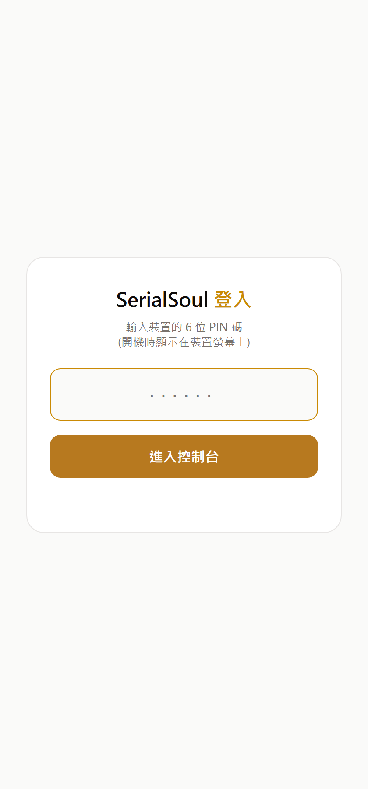
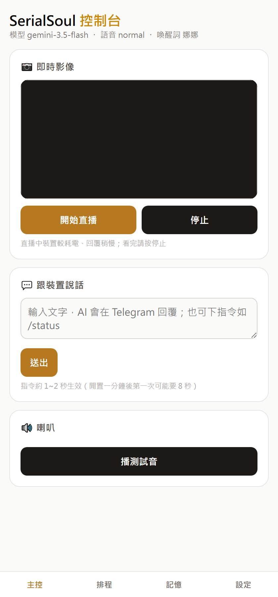
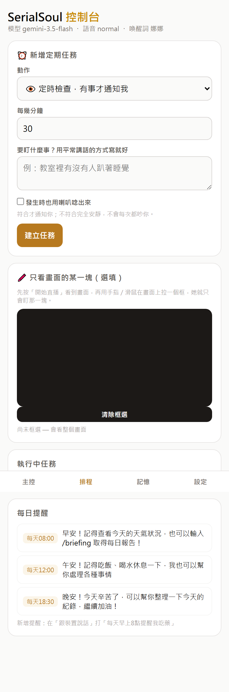
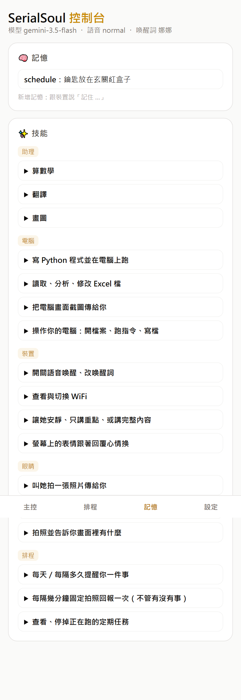
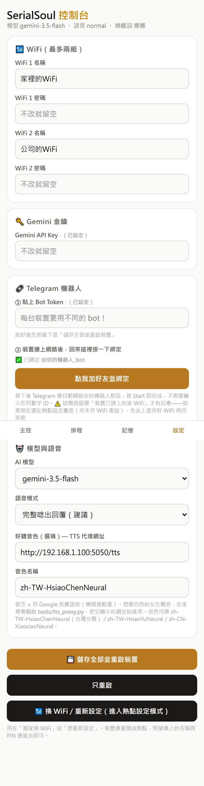

<h1 align="center">NANA</h1>

<h3 align="center">An AI that keeps an eye on things for you — and stays quiet until something actually happens.</h3>

<p align="center">
  Point a ~US$15 ESP32-S3 camera at a gauge, a door, a machine, a screen.<br>
  Tell it in one sentence what to watch for. It checks every few minutes and pings you only when it matters.<br>
  <b>No server. No PC. No code. The whole system runs on one chip.</b>
</p>

<p align="center">
  <a href="https://github.com/ry6612-pixel/nana-esp32/stargazers"></a>
  <a href="../../actions/workflows/build.yml"></a>
  
  
  <a href="LICENSE-MIT"></a>
</p>

<p align="center">
  <b>English</b> · <a href="README.zh-TW.md">繁體中文</a> · <a href="README.ja.md">日本語</a>
</p>

<p align="center">
  
</p>

---

## Why NANA

Plenty of places have a number on a panel, a door that should be closed, or a screen someone is supposed to check — and no practical way to wire it into a system. So a person walks over every so often to look. When they get busy, they miss it.

NANA does the walking for you:

```
You:   "Check the pressure gauge every 10 minutes. Tell me if it drops below 80."
NANA:  (takes a photo every 10 minutes, asks Gemini Vision to read it)
       ... silent while everything is fine ...
       🔔 "Pressure gauge reads 76 — below 80."   → Telegram + chime + spoken aloud
```

- **One sentence instead of a project.** No RTSP streams, no port forwarding, no server, no Python. If your request is vague (*"watch the production line"*), it asks you what exactly to look for and how often, instead of guessing.
- **Quiet by default.** A conditional task only speaks up when the condition is met. Unlike a camera recorder, you don't review footage after the fact — it decides in the moment.
- **Doesn't touch the equipment.** It's just a camera looking at the panel. Nothing to rewire, no vendor approval, no changes to the machine.
- **Honest about failure.** If it can't read the image, it says so instead of making up a number — and if it fails three rounds in a row (lens covered, Wi-Fi down, quota used up), it tells you, so monitoring never dies silently.

---

## What it can do

| | What | How you use it |
|---|---|---|
| 👁️ | **Conditional watching** | *"Tell me if anyone is near the oven"* — photo on a schedule, AI checks the condition, alerts only on a match. Drag a box on the live view to watch just one region. |
| 🔢 | **Read numbers and log them** | Read a gauge, meter, counter or on-screen figure every N minutes and POST each reading to your own API/spreadsheet with a fixed JSON schema. Unreadable frames send an empty value — never a fake 0. |
| 📸 | **Scheduled photo reports** | *"Send me a photo of the front door every hour"* — regardless of what's in it. |
| ⚡ | **Switch things on a timer** | Drive a relay from a GPIO on a schedule (power a pump, a light, a fan). |
| ⏰ | **Reminders** | *"Remind me to take my medicine every day at 8:00"* — delivered to your Telegram. |
| 🗣️ | **Voice** | Wake phrase, push-to-talk, spoken replies (TTS). Ask a question out loud and hear the answer. |
| 🧠 | **Memory** | *"Remember the keys are in the red box"* — ask later and it knows. Stored on the chip, survives power loss. |
| 🧩 | **24 built-in skills** | Including four "consultant" skills that interview you when a request is unclear: monitoring advisor, camera placement guide, reporting setup, troubleshooting. Add your own skills in plain text. |
| 🖥️ | **Web console on the device** | Open its IP in any browser on the same Wi-Fi: live camera, chat, tasks, memories, settings. No app to install. |
| 💬 | **Telegram (optional)** | Get alerts anywhere; bind with one tap from the console. |
| 😊 | **A face, not a status screen** | Four illustrated expressions picked from the mood of each reply; the mouth moves while it speaks. CJK text renders properly (built-in 13,802-glyph font). |
| 🔄 | **Takes care of itself** | Wi-Fi failover across up to 5 networks, health checks, watchdog, scheduled self-restart, OTA firmware updates over Wi-Fi or Telegram. |

---

## How it works



Everything — camera capture, scheduling, the web console, Telegram, retries, memory — runs in Rust on the ESP32-S3 itself. The only external service is the AI model (Google Gemini, with your own API key).

---

## Real-world test: reading a live game's scoreboard

We pointed NANA at a monitor running a League of Legends match and told it: *every minute, read the player's K/D/A and log it.* A game is a harder test than a gauge — the digits are tiny, the screen never stops moving, and the camera was mounted sideways at an angle.

Below is the **unedited log** it wrote, one row per reading, each with the exact frame it judged (columns: time · K/D/A · full reply · read OK · frame):

<p align="center"></p>

- The first rows say *"can't see it"* — the match hadn't started yet. It didn't invent a number.
- One row came back in English instead of digits — the model hesitating. It's recorded as a failed read, not guessed.
- The last row, **4/5/14**, is the frame below — the K/D/A in the top bar matches the log exactly:

<p align="center">
  
  
</p>
<p align="center"><sub>Raw frame from the device camera (rotated upright; highlight added). Keeping the photo next to every reading is what makes the log checkable — numbers on their own always look plausible.</sub></p>

<sub>League of Legends is a trademark of Riot Games, Inc. NANA isn't endorsed by Riot Games and isn't affiliated with it.</sub>

---

## See it

> Real screenshots of the web console served by the device. The UI is currently in Traditional Chinese — translations are a great first contribution.

<table>
<tr>
<td align="center" width="33%"><br><b>PIN login</b><br><sub>Per-device random PIN shown on the LCD, with lockout after 5 wrong tries.</sub></td>
<td align="center" width="33%"><br><b>Console</b><br><sub>Live camera, type to talk to it, speaker test. Works without Telegram.</sub></td>
<td align="center" width="33%"><br><b>Watch tasks</b><br><sub>Describe what to watch for, pick an interval, optionally box a region.</sub></td>
</tr>
<tr>
<td align="center"><br><b>Memory &amp; skills</b><br><sub>Everything it remembers, and every skill with the phrasing that triggers it.</sub></td>
<td align="center"><br><b>Settings</b><br><sub>Wi-Fi, keys, Telegram binding, model, voice.</sub></td>
<td align="center"><sub>Want to help? A short GIF of NANA catching something real would make this page much better — PRs welcome.</sub></td>
</tr>
</table>

---

## Hardware

| Part | Notes | Approx. price |
|---|---|---|
| **ESP32-S3-N16R8** | 16 MB flash, 8 MB PSRAM — required | ~US$8 |
| OV3660 camera | needed for anything vision-related | ~US$3 |
| ST7789 LCD, 240×320 | face, setup info, console IP + PIN | ~US$2 |
| I2S speaker amp (MAX98357A) + speaker | spoken replies, alert chime | ~US$1–2 |
| I2S microphone (INMP441) | voice input, wake phrase | ~US$1 |

**About US$15 in parts.** Only the ESP32-S3 is mandatory; missing peripherals are detected and skipped.

<details>
<summary><b>Default pins</b> (change any of them at runtime with <code>/camera pins</code>, <code>/lcd pins</code>, <code>/audio pins</code>)</summary>

**OV3660 (DVP):** XCLK 15 · SDA 4 · SCL 5 · D0 11 · D1 9 · D2 8 · D3 10 · D4 12 · D5 18 · D6 17 · D7 16 · VSYNC 6 · HREF 7 · PCLK 13 · PWDN/RESET not used

**ST7789 (SPI):** RST 21 · DC 47 · BL 38 · SCLK 19 · MOSI 20 · CS 45

**Speaker (I2S out):** BCLK 40 · WS/LRC 41 · DIN 39

**Microphone (I2S in):** SCK 2 · WS 1 · SD 42

</details>

### What it costs to run

The AI calls go to your own Gemini API key — NANA never sees or resells them. As a rough guide from our own use, checking once every 10 minutes for 8 hours a day costs well under US$1 a month on a Flash model; checking every 5 minutes around the clock is still only a few dollars. Prices change, so check Google's current pricing. A built-in limiter caps the device at 30 AI calls per minute.

---

<a id="quick-start"></a>

## Quick start

### 1. Get the firmware onto the board

**Prebuilt image** (when a [Release](../../releases) is available — no toolchain needed):

```bash
cargo install espflash
espflash write-bin -p <PORT> 0x0 NANA-<version>.bin
```

> This image starts at `0x0` and **erases all settings** on the board — right for a new board. To update a board that is already set up, flash only the app (`flash.ps1`).

**Build from source:**

```bash
git clone https://github.com/ry6612-pixel/nana-esp32.git
cd nana-esp32
cargo install espup espflash && espup install     # Xtensa Rust toolchain
. ~/export-esp.sh                                 # Windows: . $HOME\export-esp.ps1
cargo build --release                             # first build downloads ESP-IDF (~30–40 min)
espflash flash -p <PORT> --partition-table partitions.csv target/xtensa-esp32s3-espidf/release/esp32
```

On Windows, `build.ps1` / `flash.ps1` wrap these steps. The wake-word model lives in its own flash partition that `espflash flash` doesn't write: for voice wake-up, flash the single-file image from `make-bin.ps1` (or a Release) once; after that, app-only updates keep it.

### 2. Set it up from your phone

1. Power it on. The screen shows a hotspot name (`NANA-XXXX`), a **hotspot password** and a **login PIN**. The hotspot password is new every time setup mode starts.
2. Join that hotspot from your phone. The setup page opens by itself (if not, browse to `10.1.1.1`); log in with the PIN.
3. Enter your Wi-Fi and your [Gemini API key](https://aistudio.google.com/apikey). Optionally add a Telegram bot token from [@BotFather](https://t.me/BotFather). Save — it restarts and joins your Wi-Fi.
4. The screen now shows the console address and PIN. Open it in any browser on the same Wi-Fi.
5. (Optional) In the console's Telegram card, press the bind button and tap **Start** in Telegram. That's it.

Prefer USB? `provision.ps1` sends the same settings over the serial port; secrets are never compiled into the firmware.

### 3. Give it something to watch

Type into the console or Telegram:

> *Every 10 minutes, look at the panel on the left. If the temperature is above 35 °C, tell me and say it out loud.*

Not sure how to phrase it? Just say what you want (*"keep an eye on the printer"*) — the monitoring advisor skill will ask the questions it needs.

---

## Commands

You can do everything in plain language, but every feature also has a command (type `/help` on the device for the full list).

| Area | Commands |
|---|---|
| System | `/status` · `/diag` · `/tokens` · `/model set flash\|pro\|gemini-<name>` · `/ai temp auto\|0.0–1.0` |
| Camera | `/camera snap` · `/camera vision [question]` · `/camera stream` · `/camera pins …` |
| Tasks & reminders | `/autotask <sentence>` · `/tasks` · `/tasks del <id>` · `/remind 5m <msg>` · `/remind 8:00 <msg>` · `/reminders` · `/stop` · `/pause` · `/resume` |
| Reporting | `/report set <https-url>` · `/report token <token>` · `/report test` · `/report off` |
| Memory & skills | `/remember <key> <value>` · `/memories` · `/forget <key>` · `/skills` · `/skill add name\|desc\|trigger` |
| Voice & screen | `/voice off\|normal\|brief` · `/audio wake on\|off` · `/audio pins …` · `/lcd pins …` |
| Wi-Fi & updates | `/wifi set <ssid> <pass>` · `/wifi set2…5` · `/wifi swap` · `/setup` · `/ota <https-url>` · send a `.bin` in Telegram |
| Reset | `/clear` (conversation only) · `/reset confirm` (factory reset — erases Wi-Fi and keys, keeps memories and tasks) |

---

## Built to keep working unattended

The worst failure for a monitoring device isn't crashing — it's **failing silently**. So every scheduled task runs inside a bounded retry loop:

```
capture → AI read → ok? ── yes → report / notify, reset retry budget
                     │            (sends "back to normal" if it had alerted)
                     └── no ──→ retry in 70 s with a higher vision temperature (up to 5×)
                                 3 failed rounds in a row → alert you, once
```

- **Retries change something.** Asking the same model the same thing about the same frame usually returns the same wrong answer, so each retry raises the vision temperature (0.4 → 0.6 → 0.8, capped at 0.9) and resets after a success.
- **Bounded.** At most 5 retries per round, so one broken task can't burn your quota or starve the others.
- **Recovery is reported too**, so you know when it's healthy again.
- Underneath: task watchdog with automatic restart on hangs, Wi-Fi health checks and failover, heap monitoring with self-restart, and a scheduled 4 a.m. restart.

---

## Send readings to your own system

```
/report set https://your.domain/api/readings
/report token YOUR_TOKEN        # optional, sent as Authorization: Bearer
/report test                    # sends one test row
```

The URL is validated when you set it. Every reading is POSTed as JSON with a fixed shape:

```json
{
  "device": "NANA-7A3E",
  "task_id": 68,
  "task_type": "camera",
  "ts": 1785639147,
  "prompt": "read the output figure on screen, digits only",
  "value": "1210",
  "text": "1210",
  "hit": true,
  "ok": true
}
```

| Field | Meaning |
|---|---|
| `device` | Device name (same as its hotspot) — tells multiple units apart |
| `task_id`, `task_type` | Which task; `camera` (every round), `watch` (conditional) or `test` |
| `ts` | Unix seconds |
| `prompt` | What it was asked to look for |
| `value` | Extracted number, or **empty string** when nothing was readable |
| `text` | Full reply |
| `hit` | For `watch`: whether the condition held (rows are sent even when it didn't, so "all clear" is distinguishable from "not running") |
| `ok` | Whether the read itself succeeded |

After 3 failed deliveries it alerts you — data disappearing silently is worse than no reporting at all.

---

## Is it right for you?

**Great fit**
- A machine or panel shows a number but can't be connected to your system
- Someone checks something by eye every day: temperature, water level, pressure, an indicator light
- You want to know *when* something happens, but nobody watches the camera feed
- You need a record, but today it's written down by hand

**Not a fit (yet)**
- No Wi-Fi or no power at the spot
- The thing you care about isn't visible (sound, smell, vibration)
- You need millisecond reactions — NANA checks every few minutes
- Accuracy depends on lighting, angle, glare and digit size. Test it on your own panel before relying on it; NANA reports "can't read it" rather than guessing.

---

## Security & privacy

**Built in**
- No secrets in source or firmware — keys are entered on the device and stored in NVS.
- Setup hotspot is **WPA2 with a fresh 8-character password** shown only on the screen (and the USB serial log). Switch: `SETUP_AP_SECURED`.
- BLE provisioning is **off by default** (`BLE_PROVISIONING_ENABLED`); its link is not encrypted yet.
- Web console: per-device PIN with lockout, HttpOnly session cookie, all stored text escaped before display.
- Telegram: binding needs a one-time code from the logged-in console, private chats only; the bot answers only its owner.
- Voice transcripts are always treated as chat, never as commands.
- PC control (see below) is locked by default; `/pc_unlock` opens a 10-minute window.
- OTA only accepts HTTPS URLs. Chat content is not written to the serial log.

**Know before you deploy**
- Photos, voice and text are sent to Google Gemini for analysis.
- The web console and live view use plain HTTP on your local network.
- Keys are stored without flash encryption — anyone holding the board can read them.
- OTA images are not signature-checked.
- It's a camera: tell people in view that they are being monitored and follow your local privacy law.

Found a problem? Please open an issue (or a private security advisory for anything sensitive).

---

## Experimental: PC control

The firmware speaks a JSON-lines protocol over USB so the AI can take screenshots, open files, run commands or work with Excel on a connected PC. **The host-side driver is not published yet**, so these commands do nothing on their own today. They stay locked by default either way.

---

## FAQ

<details><summary><b>Do I need Telegram?</b></summary>
No. The web console does everything. Telegram is only for getting alerts when you're away.
</details>

<details><summary><b>Which languages does it understand?</b></summary>
It replies in whatever language you write or speak. The console UI is currently Traditional Chinese.
</details>

<details><summary><b>Can I use another AI model?</b></summary>
Any Gemini model: <code>/model set gemini-&lt;name&gt;</code>. The default, <code>gemini-flash-latest</code>, follows Google's newest Flash model automatically.
</details>

<details><summary><b>How is this different from xiaozhi-esp32?</b></summary>
xiaozhi-esp32 is a great voice-chat assistant. NANA is built around <i>watching</i>: scheduled vision checks, conditional alerts, readings into your own system. Different jobs — they complement each other.
</details>

<details><summary><b>How is this different from OpenClaw / ZeroClaw?</b></summary>
Those are AI agent platforms that run on a computer or server (and can use an ESP32 as a peripheral). NANA has no host at all — the ESP32-S3 <i>is</i> the whole system.
</details>

---

## Contributing

Issues and PRs are very welcome — especially an English/Japanese console UI, a browser-based flasher, more board pin presets, and real-world demo GIFs.

If NANA saves you a walk to the machine, **a ⭐ helps other people find it.**

## License

Dual-licensed under [MIT](LICENSE-MIT) or [Apache-2.0](LICENSE-APACHE), at your option. The bitmap font in `assets/font16.bin` is derived from Noto Sans TC and is licensed under the [SIL Open Font License 1.1](assets/font16.OFL.txt).

NANA was previously developed under the name *SerialSoul*; you'll still see that name in parts of the code and console.

## Acknowledgments

- [Espressif](https://www.espressif.com/) — the ESP32-S3 and ESP-IDF
- [esp-rs](https://github.com/esp-rs) — Rust on ESP32
- [Google Gemini](https://ai.google.dev/) — the vision model behind the judgement calls
- [xiaozhi-esp32](https://github.com/78/xiaozhi-esp32) — for showing what an ESP32 AI companion can be
- [Noto Sans TC](https://fonts.google.com/noto/specimen/Noto+Sans+TC) — CJK font
