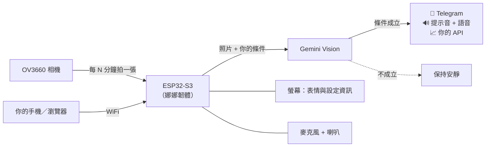
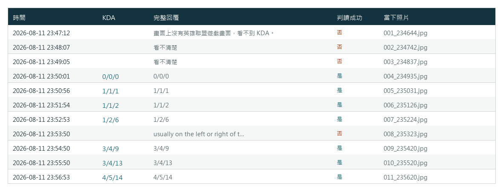
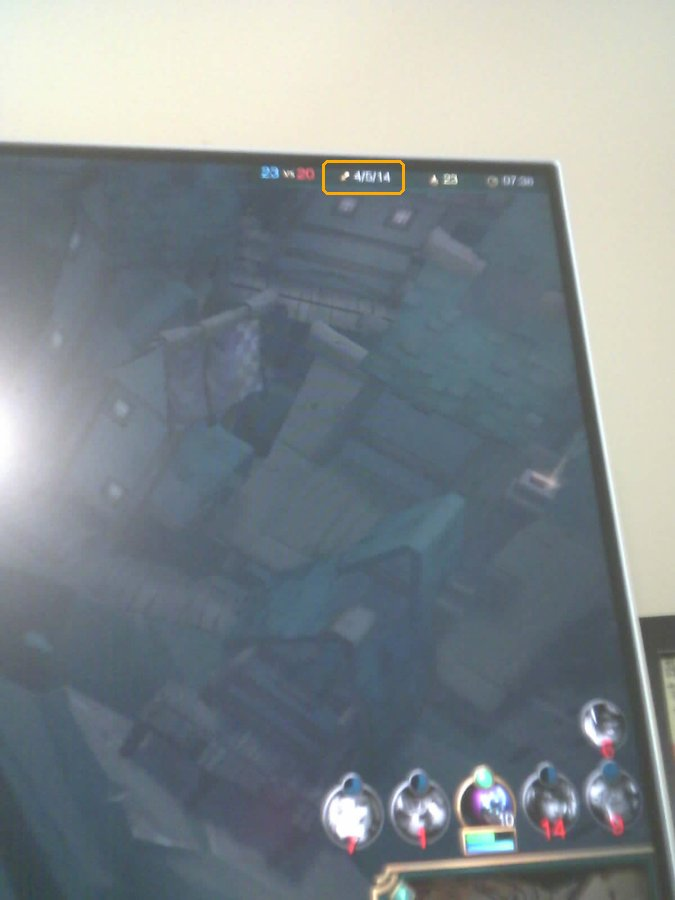
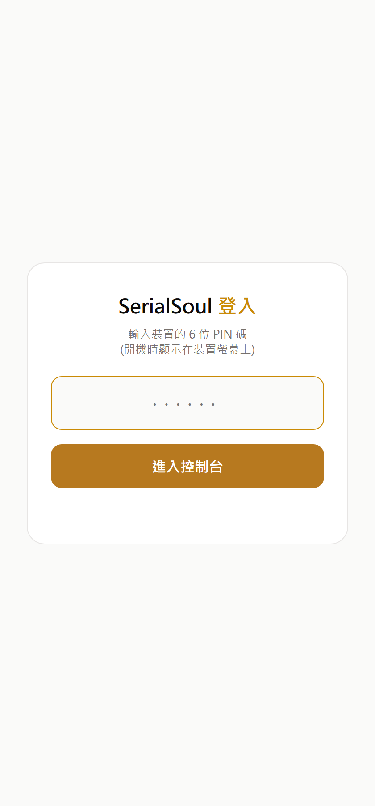
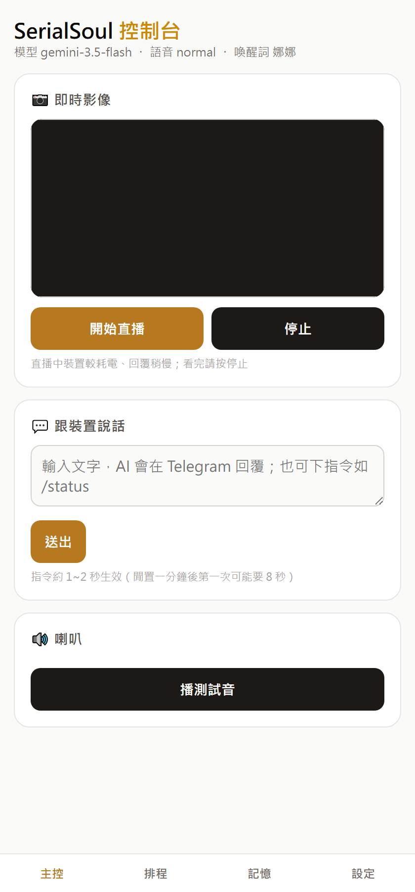
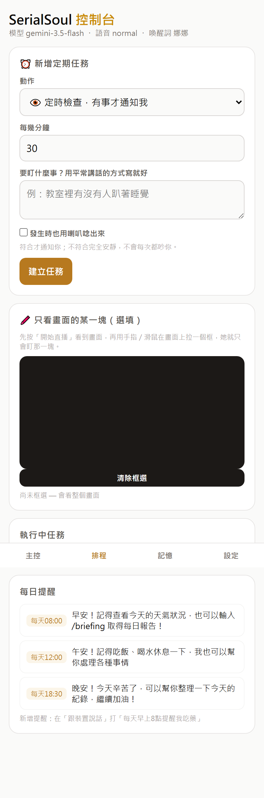
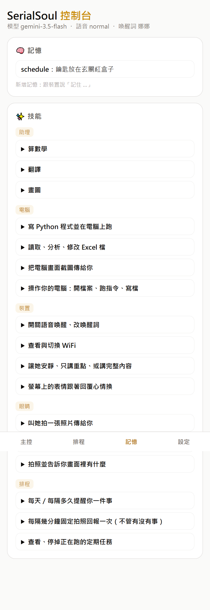
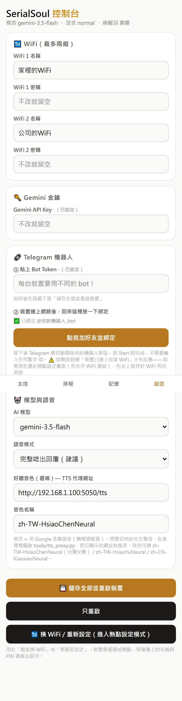

<h1 align="center">NANA 娜娜</h1>

<h3 align="center">幫你盯著看的 AI —— 沒事完全安靜，有事才叫你。</h3>

<p align="center">
  把一台約 NT$500 的 ESP32-S3 相機對準儀表、門口、機台或螢幕，<br>
  用一句話告訴它要盯什麼。它每幾分鐘看一次，符合條件才通知你。<br>
  <b>不用架伺服器、不用開電腦、不用寫程式 —— 整套系統跑在一顆晶片上。</b>
</p>

<p align="center">
  <a href="https://github.com/ry6612-pixel/nana-esp32/stargazers"></a>
  <a href="../../actions/workflows/build.yml"></a>
  
  
  <a href="LICENSE-MIT"></a>
</p>

<p align="center">
  <a href="README.md">English</a> · <b>繁體中文</b> · <a href="README.ja.md">日本語</a>
</p>

<p align="center">
  
</p>

---

## 為什麼做娜娜

很多現場是這樣：機台有面板、有數字，但接不進系統；想接，原廠說要換整台。只好派人每隔一段時間走過去看一眼 —— 人一忙就漏看，往往是漏看了才發現出事。

娜娜替你走這一趟：

```
你：  「每 10 分鐘看一下壓力錶，低於 80 就通知我。」
娜娜：（每 10 分鐘拍一張，請 Gemini Vision 判讀）
      …… 一切正常時完全安靜 ……
      🔔「壓力錶讀數 76，低於 80。」  → Telegram 通知 + 現場提示音 + 唸出來
```

- **一句話，不是一個專案。** 不用接 RTSP 串流、不用設路由器、不用架伺服器、不用寫 Python。你講得含糊（「幫我盯著產線」），它會反過來問你要盯什麼、多久看一次，不會自己亂猜。
- **平常完全安靜。** 條件式任務只在條件成立時才出聲。跟監視器不一樣：監視器是錄起來、出事後你去翻帶子；娜娜是當下就判斷。
- **不碰原本的設備。** 對機台來說，它只是旁邊多了一台相機。不接線、不改機、不用原廠同意。
- **讀不到就老實說。** 看不清楚就回報「看不到」，不會硬編一個數字；連續三輪失敗（鏡頭被擋、網路斷、額度用完）會主動告訴你，監看不會無聲無息地停掉。

---

## 它能做什麼

| | 功能 | 怎麼用 |
|---|---|---|
| 👁️ | **條件式監看** | 「有人靠近烤箱就告訴我」—— 定時拍照、AI 判斷條件、符合才通知。可以在即時畫面上框選，只盯某一區。 |
| 🔢 | **讀數字並記錄** | 每 N 分鐘讀儀表、電表、計數器或螢幕上的數字，每一筆以固定 JSON 格式 POST 到你的 API／試算表。讀不到就送空值，絕不填假的 0。 |
| 📸 | **定時拍照回報** | 「每小時拍一張門口給我」—— 不管有沒有事都傳。 |
| ⚡ | **定時開關電器** | 用 GPIO 排程控制繼電器（幫浦、燈、風扇）。 |
| ⏰ | **提醒** | 「每天早上 8 點提醒我吃藥」—— 送到你的 Telegram。 |
| 🗣️ | **語音** | 喚醒詞、按鍵說話、語音回覆（TTS）。開口問，它用講的回答。 |
| 🧠 | **記憶** | 「記住鑰匙在紅盒子」—— 之後問得到。存在晶片裡，斷電不會掉。 |
| 🧩 | **24 個內建技能** | 其中四個是「顧問」：需求講不清楚時會訪談你 —— 監控顧問、裝機指引、上報設定、故障排除。也能用一般文字新增自己的技能。 |
| 🖥️ | **裝置自帶網頁控制台** | 同一個 WiFi 下用瀏覽器開它的 IP：即時影像、對話、任務、記憶、設定。不用裝 App。 |
| 💬 | **Telegram（選用）** | 人在外面也收得到通知；在控制台按一下就能綁定。 |
| 😊 | **一張臉，不是狀態列** | 依每次回覆的情緒切換四種插畫表情，講話時嘴巴會動。中文正常顯示（內建 13,802 字點陣字型）。 |
| 🔄 | **自己照顧自己** | 最多 5 組 WiFi 備援、連線健康檢查、看門狗、定時自我重啟，韌體可經 WiFi 或 Telegram 線上更新（OTA）。 |

---

## 運作方式



拍照、排程、網頁控制台、Telegram、重試、記憶 —— 全部用 Rust 跑在 ESP32-S3 上。唯一的外部服務是 AI 模型（Google Gemini，用你自己的 API 金鑰）。

---

## 實測：讀遊戲畫面的戰績

我們把娜娜對著正在打英雄聯盟的螢幕，交代一句：**每分鐘讀一次玩家的 K/D/A 並記下來。** 遊戲比儀表難讀 —— 字更小、畫面一直在動，鏡頭還是側著、斜著拍的。

下面是它寫出來的**原始紀錄（未經整理）**，每一列是一次判讀，附上它當下判讀的那張照片（欄位：時間 · KDA · 完整回覆 · 判讀成功 · 當下照片）：

<p align="center"></p>

- 前幾列寫「看不清楚」—— 那時遊戲還沒開始。它沒有硬編一個數字。
- 中間有一列回了英文而不是數字 —— 那是模型在猶豫，被記成判讀失敗，不是亂猜。
- 最後一列 **4/5/14** 就是下面這張照片 —— 上方戰績列的 K/D/A 與紀錄完全一致：

<p align="center">
  
  
</p>
<p align="center"><sub>裝置相機拍到的原始畫面（轉正顯示、加上框線標示）。每筆讀數都留著當下照片，紀錄才驗得出對錯 —— 只看數字，永遠看起來都很合理。</sub></p>

<sub>英雄聯盟（League of Legends）是 Riot Games, Inc. 的商標。娜娜與 Riot Games 無關，也未獲其背書。</sub>

---

## 實際畫面

> 以下是裝置提供的網頁控制台實際截圖。

<table>
<tr>
<td align="center" width="33%"><br><b>PIN 登入</b><br><sub>每台隨機產生、顯示在螢幕上；連錯 5 次會鎖定。</sub></td>
<td align="center" width="33%"><br><b>主控</b><br><sub>即時影像、打字跟它說話、喇叭測試。不需要 Telegram。</sub></td>
<td align="center" width="33%"><br><b>監看任務</b><br><sub>寫下要盯什麼、選間隔，可框選只盯某一區。</sub></td>
</tr>
<tr>
<td align="center"><br><b>記憶與技能</b><br><sub>它記得的事，以及每個技能用什麼講法觸發。</sub></td>
<td align="center"><br><b>設定</b><br><sub>WiFi、金鑰、Telegram 綁定、模型、語音。</sub></td>
<td align="center"><sub>歡迎貢獻：一段娜娜實際抓到狀況的短 GIF，會讓這一頁好看很多。</sub></td>
</tr>
</table>

---

## 硬體

| 零件 | 說明 | 參考價 |
|---|---|---|
| **ESP32-S3-N16R8** | 16 MB Flash、8 MB PSRAM —— 必要 | 約 NT$250 |
| OV3660 相機 | 所有視覺功能都需要 | 約 NT$100 |
| ST7789 螢幕 240×320 | 表情、設定資訊、控制台 IP 與 PIN | 約 NT$70 |
| I2S 喇叭擴大機（MAX98357A）+ 喇叭 | 語音回覆、提示音 | 約 NT$50 |
| I2S 麥克風（INMP441） | 語音輸入、喚醒詞 | 約 NT$40 |

**零件約 NT$500。** 只有 ESP32-S3 是必要的，沒接的周邊會自動偵測並略過。

<details>
<summary><b>預設腳位</b>（都可以在執行中用 <code>/camera pins</code>、<code>/lcd pins</code>、<code>/audio pins</code> 修改）</summary>

**OV3660（DVP）：** XCLK 15 · SDA 4 · SCL 5 · D0 11 · D1 9 · D2 8 · D3 10 · D4 12 · D5 18 · D6 17 · D7 16 · VSYNC 6 · HREF 7 · PCLK 13 · PWDN/RESET 不使用

**ST7789（SPI）：** RST 21 · DC 47 · BL 38 · SCLK 19 · MOSI 20 · CS 45

**喇叭（I2S 輸出）：** BCLK 40 · WS/LRC 41 · DIN 39

**麥克風（I2S 輸入）：** SCK 2 · WS 1 · SD 42

</details>

### 用起來要花多少錢

AI 費用是用你自己的 Gemini API 金鑰直接付給 Google，娜娜不經手、不加價。以我們自己的使用估算：每 10 分鐘看一次、每天 8 小時，用 Flash 模型一個月約 NT$11；每 5 分鐘一次、24 小時不停，一個月約 NT$68。價格會變動，請以 Google 目前公告為準。裝置內建限流，每分鐘最多 30 次 AI 呼叫。

---

<a id="快速開始"></a>

## 快速開始

### 1. 把韌體燒進板子

**現成映像檔**（有 [Release](../../releases) 時可用，不需要編譯環境）：

```bash
cargo install espflash
espflash write-bin -p <序列埠> 0x0 NANA-<版本>.bin
```

> 這個映像從 `0x0` 開始，**會清空板子上的所有設定** —— 新板子正好需要這樣。已經設定好的板子要更新，請只燒 app（`flash.ps1`）。

**從原始碼建置：**

```bash
git clone https://github.com/ry6612-pixel/nana-esp32.git
cd nana-esp32
cargo install espup espflash && espup install     # Xtensa Rust 工具鏈
. ~/export-esp.sh                                 # Windows：. $HOME\export-esp.ps1
cargo build --release                             # 第一次會下載 ESP-IDF（約 30–40 分鐘）
espflash flash -p <序列埠> --partition-table partitions.csv target/xtensa-esp32s3-espidf/release/esp32
```

Windows 可以直接用 `build.ps1`／`flash.ps1`。語音喚醒模型在獨立的 flash 分割區，`espflash flash` 不會寫它：要用語音喚醒，先燒一次 `make-bin.ps1`（或 Release）產生的單檔映像，之後只更新 app 就會保留。

### 2. 用手機完成設定

1. 插上電。螢幕會顯示熱點名稱（`NANA-XXXX`）、**熱點密碼**與**登入密碼（PIN）**。熱點密碼每次進設定模式都不同。
2. 手機連上這個熱點，設定頁會自動跳出（沒有的話開 `10.1.1.1`），用 PIN 登入。
3. 填入 WiFi 與 [Gemini API 金鑰](https://aistudio.google.com/apikey)，需要的話再貼 [@BotFather](https://t.me/BotFather) 給的 Telegram bot token。存檔後它會重開機並連上你的 WiFi。
4. 螢幕改顯示控制台網址與 PIN，同一個 WiFi 下用瀏覽器打開即可。
5. （選用）在控制台的 Telegram 卡片按「點我加好友並綁定」，到 Telegram 按 **Start**，完成。

詳細圖文步驟見 [開箱設定指南](docs/SOP_開箱設定指南.md)。想用 USB？`provision.ps1` 會透過序列埠送同樣的設定；金鑰永遠不會編進韌體。

### 3. 給它一件事盯

在控制台或 Telegram 打：

> 每 10 分鐘看左邊那個面板，溫度超過 35 度就通知我，並且唸出來。

不知道怎麼講？直接說你要什麼（「幫我注意一下印表機」），監控顧問技能會問它需要的資訊。

---

## 指令

所有功能都能用一般說話的方式完成，但每個功能也都有對應指令（在裝置上打 `/help` 看完整清單）。

| 類別 | 指令 |
|---|---|
| 系統 | `/status` · `/diag` · `/tokens` · `/model set flash\|pro\|gemini-<名稱>` · `/ai temp auto\|0.0–1.0` |
| 相機 | `/camera snap` · `/camera vision [問題]` · `/camera stream` · `/camera pins …` |
| 任務與提醒 | `/autotask <一句話>` · `/tasks` · `/tasks del <編號>` · `/remind 5m <內容>` · `/remind 8:00 <內容>` · `/reminders` · `/stop` · `/pause` · `/resume` |
| 上報 | `/report set <https 網址>` · `/report token <token>` · `/report test` · `/report off` |
| 記憶與技能 | `/remember <鍵> <值>` · `/memories` · `/forget <鍵>` · `/skills` · `/skill add 名稱\|說明\|觸發詞` |
| 語音與螢幕 | `/voice off\|normal\|brief` · `/audio wake on\|off` · `/audio pins …` · `/lcd pins …` |
| WiFi 與更新 | `/wifi set <SSID> <密碼>` · `/wifi set2…5` · `/wifi swap` · `/setup` · `/ota <https 網址>` · 在 Telegram 傳 `.bin` 檔 |
| 重置 | `/clear`（只清對話）· `/reset confirm`（恢復原廠：清除 WiFi 與金鑰，保留記憶與任務） |

---

## 為無人看管而設計

監看裝置最糟的不是當機，而是**無聲無息地失效**。所以每個定時任務都跑在有上限的重試迴圈裡：

```
拍照 → AI 判讀 → 成功？ ── 是 → 上報／通知，重試額度補滿
                     │          （之前告警過的話，送一則「已恢復」）
                     └── 否 → 70 秒後換較高的判讀溫度再試（最多 5 次）
                               連續 3 輪失敗 → 通知你一次
```

- **重試會換條件。** 同一張畫面、同一個問題、同一個溫度，通常會得到同一個錯誤答案；所以每次重試把判讀溫度往上調（0.4 → 0.6 → 0.8，上限 0.9），成功後回到 0.4。
- **有上限。** 每輪最多重試 5 次，一個壞掉的任務不會燒光你的額度、也不會拖垮其他任務。
- **恢復也會通知**，你知道它什麼時候又正常了。
- 底層還有：卡死自動重啟的看門狗、WiFi 健康檢查與備援、記憶體監控與自救重啟、凌晨 4 點例行重啟。

---

## 把讀數送進你自己的系統

```
/report set https://your.domain/api/readings
/report token YOUR_TOKEN        # 選用，以 Authorization: Bearer 送出
/report test                    # 送一筆測試資料
```

設定網址的當下就會驗證格式。每一筆讀數以固定格式的 JSON POST 出去：

```json
{
  "device": "NANA-7A3E",
  "task_id": 68,
  "task_type": "camera",
  "ts": 1785639147,
  "prompt": "read the output figure on screen, digits only",
  "value": "1210",
  "text": "1210",
  "hit": true,
  "ok": true
}
```

| 欄位 | 意思 |
|---|---|
| `device` | 裝置名稱（與熱點同名），多台寫進同一個資料庫時靠它分辨 |
| `task_id`、`task_type` | 哪個任務；`camera`（每輪都報）、`watch`（條件式）或 `test` |
| `ts` | Unix 秒 |
| `prompt` | 要它看什麼 |
| `value` | 抽出的數字；讀不到時是**空字串** |
| `text` | 完整回覆 |
| `hit` | `watch` 專用：條件是否成立（不成立也會送，才分得出「一切正常」和「根本沒在跑」） |
| `ok` | 這次判讀本身有沒有成功 |

連續 3 次送不出去會通知你 —— 資料無聲消失，比不上報更糟。

---

## 適不適合你

**很適合**
- 機台有面板、有數字，但接不進系統
- 每天有人要去看一眼的事：溫度、水位、壓力、指示燈
- 想知道某件事**什麼時候**發生，但沒人在盯監視器
- 要留紀錄，但現在是紙本手抄

**先別用**
- 現場沒有 WiFi 或電源
- 要判斷的東西不在畫面上（聲音、氣味、震動）
- 需要毫秒級即時反應 —— 娜娜是每幾分鐘看一次
- 準確度會受光線、角度、反光、字體大小影響。請先在你的現場實測再依賴它；看不清楚時它會說看不到，而不是亂猜。

---

## 安全與隱私

**內建保護**
- 原始碼與韌體裡沒有任何金鑰 —— 金鑰在裝置上輸入，存在 NVS。
- 設定熱點是 **WPA2，每次產生新的 8 字元密碼**，只顯示在螢幕（與 USB 序列 log）。開關：`SETUP_AP_SECURED`。
- BLE 配網**預設關閉**（`BLE_PROVISIONING_ENABLED`），它的連線目前還沒有加密。
- 網頁控制台：每台不同的 PIN，連錯會鎖定；Session Cookie 為 HttpOnly；顯示的文字一律跳脫。
- Telegram：綁定需要登入控制台後取得的一次性配對碼，只接受私訊；機器人只回應主人。
- 語音轉寫的文字一律當聊天內容，不會變成指令。
- 電腦控制（見下方）預設鎖定；`/pc_unlock` 只開放 10 分鐘。
- OTA 只接受 HTTPS 網址。聊天內容不寫進序列 log。

**部署前要知道**
- 照片、語音與文字會送到 Google Gemini 分析。
- 網頁控制台與即時影像在區域網路上是 HTTP。
- 金鑰存放時沒有 flash 加密 —— 拿到實體板子的人讀得出來。
- OTA 韌體沒有簽章驗證。
- 這是一台相機：請告知被拍到的人正在被監看，並遵守當地個資法規。

發現問題？請開 issue（敏感問題請用私下的 security advisory）。

---

## 實驗性功能：電腦控制

韌體內建一套經 USB 的 JSON Lines 協定，讓 AI 可以在連接的電腦上截圖、開檔、執行指令或處理 Excel。**電腦端的驅動程式還沒公開**，所以這些指令目前單獨用不起來。無論如何它們預設都是鎖定的。

---

## 常見問題

<details><summary><b>一定要用 Telegram 嗎？</b></summary>
不用。網頁控制台什麼都能做，Telegram 只是讓你人在外面也收得到通知。
</details>

<details><summary><b>聽得懂哪些語言？</b></summary>
你用什麼語言寫或講，它就用什麼語言回。控制台介面目前是繁體中文。
</details>

<details><summary><b>可以換別的 AI 模型嗎？</b></summary>
任何 Gemini 模型都可以：<code>/model set gemini-&lt;名稱&gt;</code>。預設的 <code>gemini-flash-latest</code> 會自動跟上 Google 最新的 Flash 模型。
</details>

<details><summary><b>跟小智（xiaozhi-esp32）有什麼不同？</b></summary>
小智是很棒的語音聊天助理。娜娜是以「盯著看」為核心：定時視覺判讀、條件式通知、把讀數送進你的系統。兩者做的事不同，可以互補。
</details>

<details><summary><b>跟 OpenClaw／ZeroClaw 有什麼不同？</b></summary>
它們是跑在電腦或伺服器上的 AI agent 平台（可以把 ESP32 當周邊）。娜娜沒有主機 —— ESP32-S3 本身就是整個系統。
</details>

---

## 參與貢獻

非常歡迎 issue 和 PR —— 特別是英文／日文控制台介面、瀏覽器直接燒錄工具、更多開發板的腳位預設，以及真實場景的示範 GIF。

如果娜娜幫你省下一趟走過去看的路，**給個 ⭐ 能讓更多人找到它。**

## 授權

採 [MIT](LICENSE-MIT) 或 [Apache-2.0](LICENSE-APACHE) 雙授權，任選其一。`assets/font16.bin` 點陣字型衍生自 Noto Sans TC，採 [SIL Open Font License 1.1](assets/font16.OFL.txt)。

娜娜之前以 *SerialSoul* 的名稱開發，程式碼與控制台裡還看得到這個名字。

## 致謝

- [Espressif 樂鑫](https://www.espressif.com/) —— ESP32-S3 與 ESP-IDF
- [esp-rs](https://github.com/esp-rs) —— 讓 ESP32 能用 Rust
- [Google Gemini](https://ai.google.dev/) —— 負責判讀的視覺模型
- [xiaozhi-esp32 小智](https://github.com/78/xiaozhi-esp32) —— 讓大家看到 ESP32 AI 夥伴的可能
- [Noto Sans TC](https://fonts.google.com/noto/specimen/Noto+Sans+TC) —— 中文字型
